<div align="center">


<br/>

📍 짧은 취향 테스트 답변을 **나만의 AI 무드보드**로 바꿔 공유하는 감성 웹 경험</br>
📎 [mood·me](https://mood-m-e.vercel.app) <br>
🎤 [발표 자료](https://mood-m-e.vercel.app/deck.html) <br>
🗓️ 2026/07/05 ~ 07/11 (`v1.0.0`)

</div>

## 📱 기능

|                                       1.첫진입 홈                                       |
| :-------------------------------------------------------------------------------------: |
| 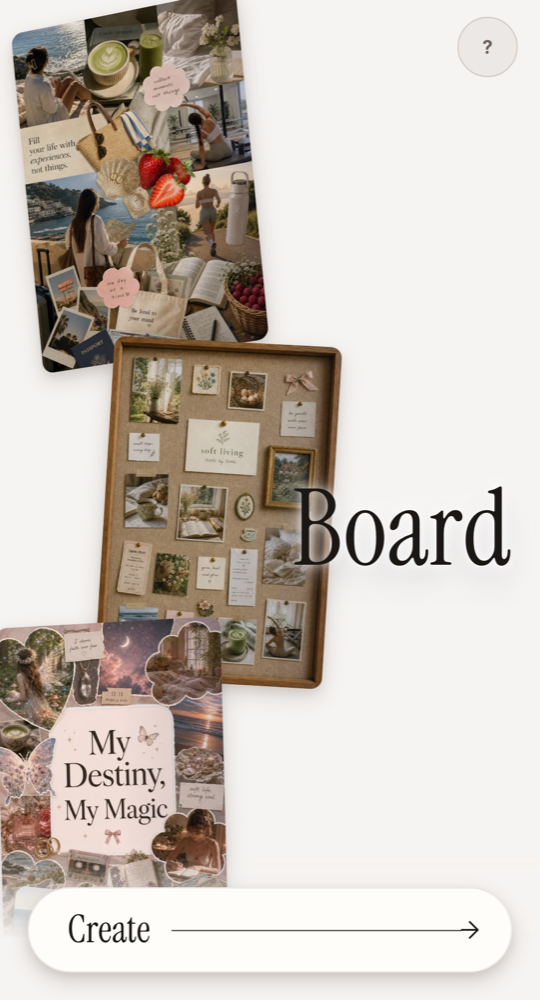 |

- 실제 AI로 만든 예시 무드보드로 결과물을 먼저 보여주며 테스트 시작 유도

### 2.추구미 테스트

|                                               담기                                               |                                              덜어내기                                              |                                               그림자                                               |
| :----------------------------------------------------------------------------------------------: | :------------------------------------------------------------------------------------------------: | :------------------------------------------------------------------------------------------------: |
| 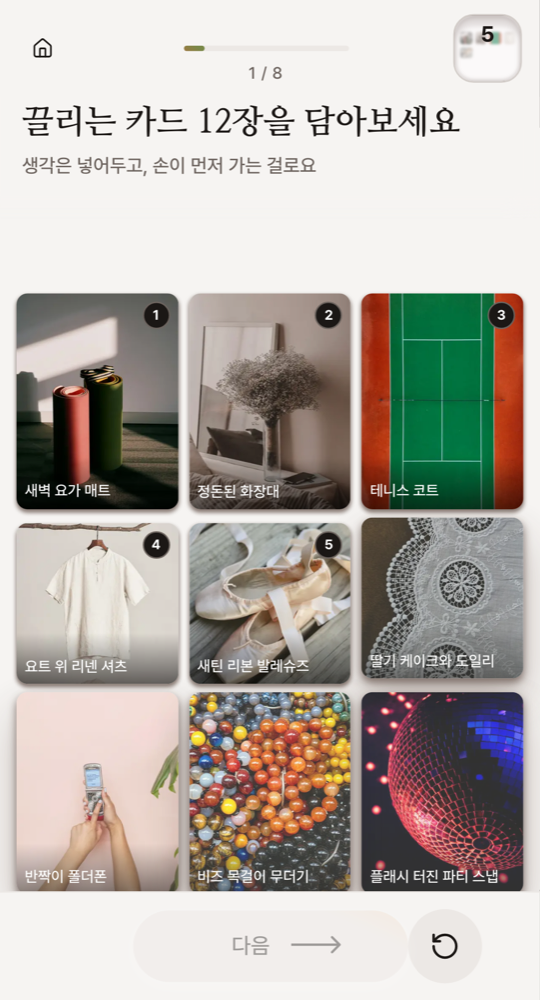 | 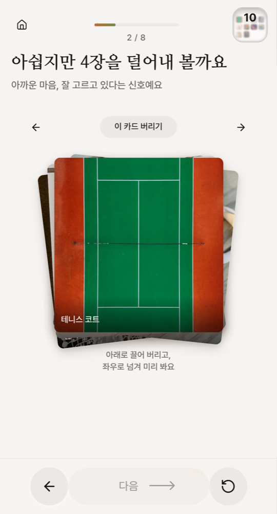 | 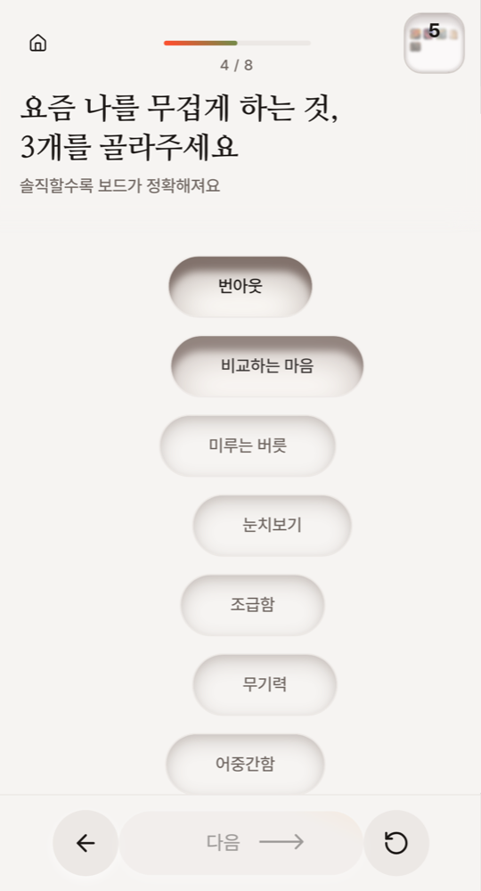 |

|                                                 전환                                                 |                                              최종 대결                                               |
| :--------------------------------------------------------------------------------------------------: | :--------------------------------------------------------------------------------------------------: |
| 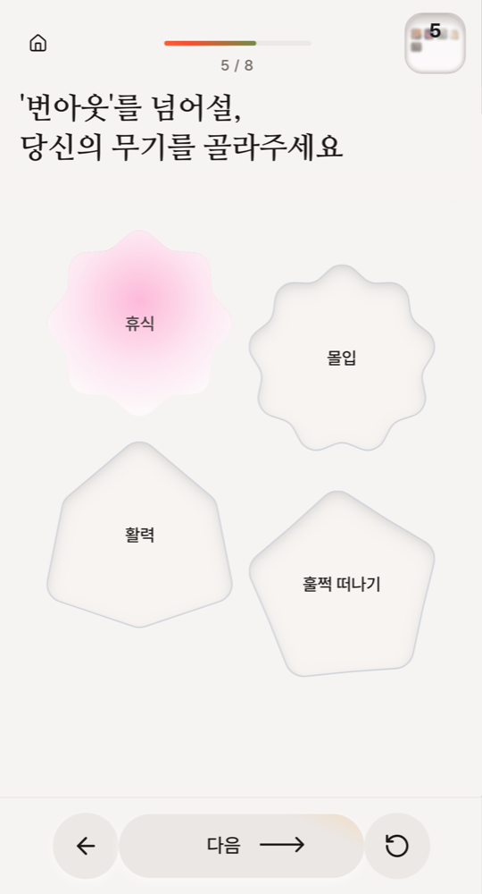 | 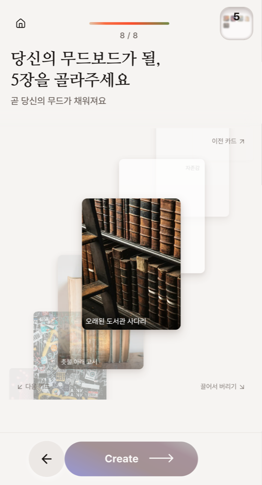 |

- 무엇을 골랐는지보다 무엇을 언제 버렸는지를 기록하는 8단계 카드 선택
  - 담기: 카드 36장 중 끌리는 12장 담기
  - 덜어내기: 담은 카드에서 4장, 다시 3장을 덜어내 확신의 가치 5장 남기기 (2단계)
  - 그림자: 요즘 나를 무겁게 하는 것 3개 고르기
  - 전환: 고른 그림자마다 넘어설 무기 하나씩 고르기 (3단계)
  - 최종 대결: 확신의 가치와 열망의 가치 중 무드보드가 될 5장 고르기
- 헤더의 미니 보드에 살아남은 카드가 쌓여, 버리는 경험을 확정의 경험으로 연출
- 고른 카드와 망설임 같은 여정 신호로 페르소나 비율을 코드로 계산

|                                     3.무드보드 생성                                     |                                           4.크롭 에디터                                            |
| :-------------------------------------------------------------------------------------: | :------------------------------------------------------------------------------------------------: |
| 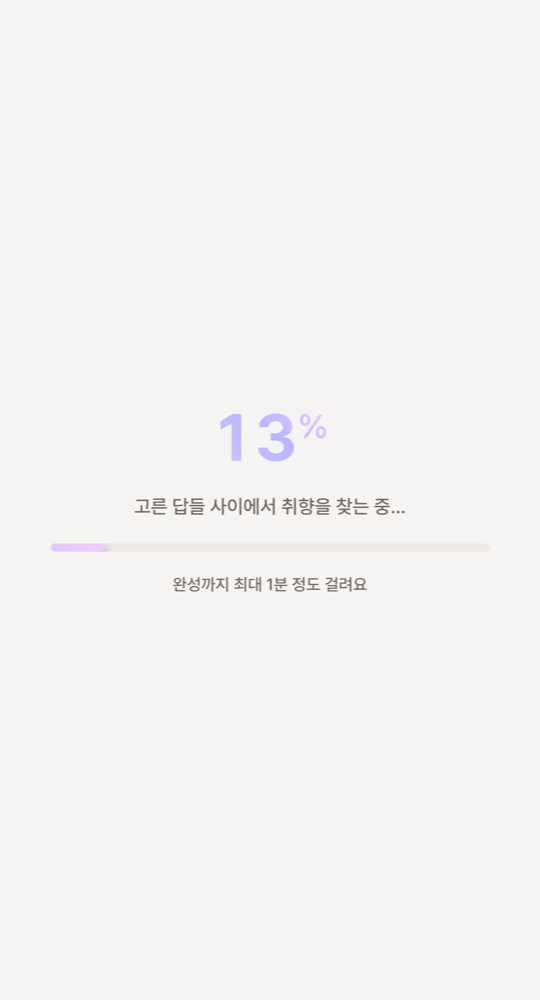 | 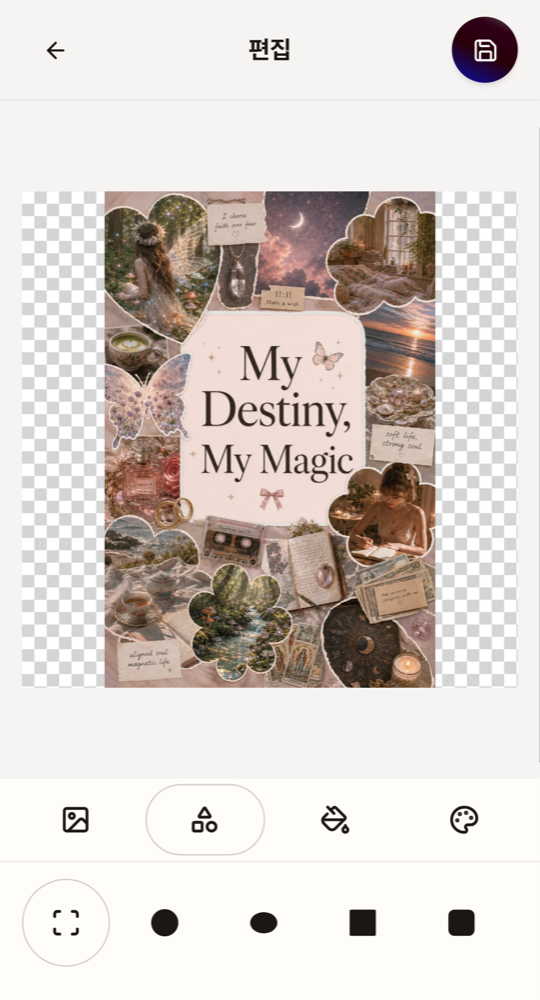 |

- GPT-5 는 무드 리포트를, GPT-Image-2 는 세로 2:3 보드 이미지를 생성
- 텍스트·이미지 생성 갈래를 분리해 한쪽만 실패해도 나머지는 살리고, 실패한 갈래만 재시도
- 진행률과 예상 소요 시간 안내, 생성 중 이탈·새로고침 경고
- Konva 캔버스에서 도형·배경·구도를 다듬어 결과물 완성

|                                            5.결과물 (무드보드)                                             |                                           5.결과물 (결과 해석)                                            |
| :--------------------------------------------------------------------------------------------------------: | :-------------------------------------------------------------------------------------------------------: |
| 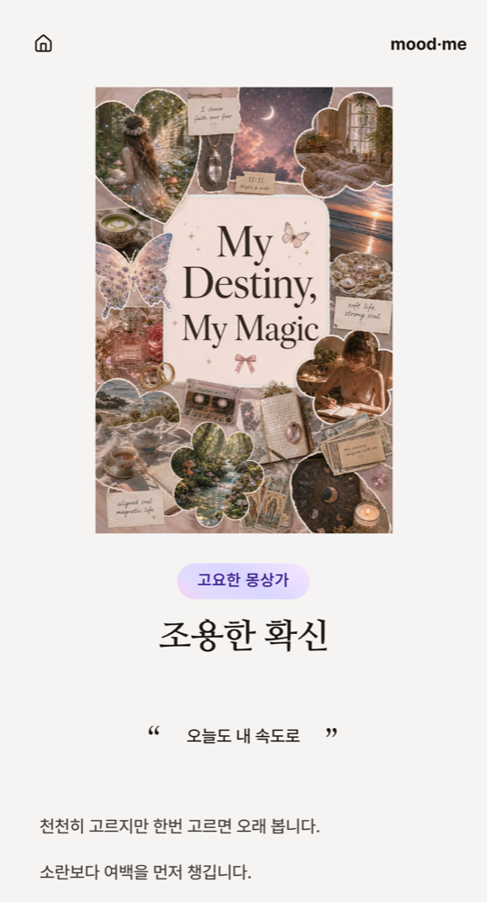 | 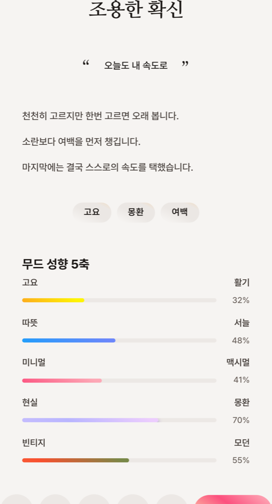 |

- 상단에 완성한 무드보드와 유형명, 타이틀 제공
- 하단에 해석 문구, 키워드, 무드 성향 5축으로 결과 해석 제공
- PNG 로 내보내 SNS 공유, 카카오톡·SNS 링크 공유 카드 설정

|                                           6.히스토리                                           |
| :--------------------------------------------------------------------------------------------: |
| 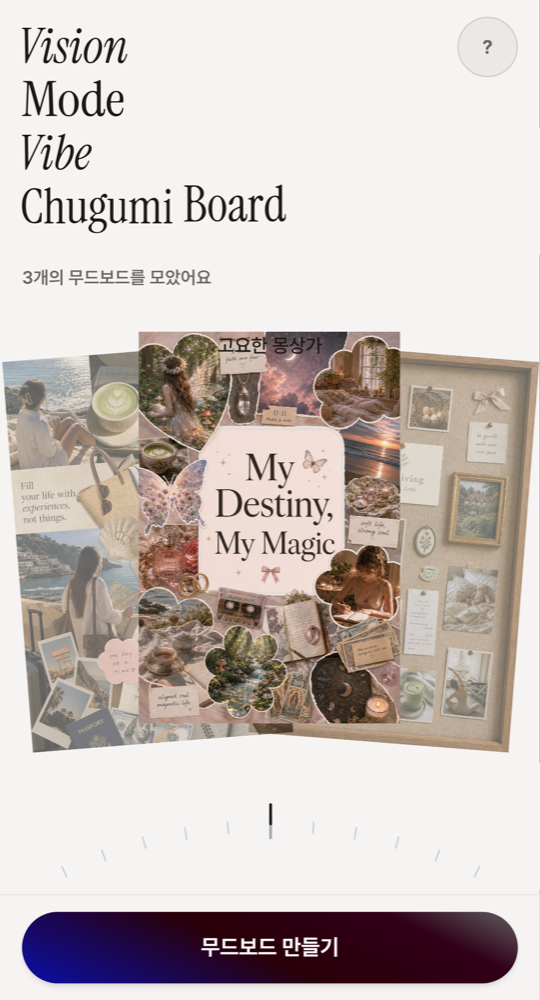 |

- 만든 무드보드를 홈 캐러셀에서 다시 보고 이어서 편집

### 7. 공통사항

- Supabase 로 카카오 로그인과 비회원(게스트) 세션 관리, 로그인 시 게스트 보드 귀속
- Elice AX 프록시 하나로 텍스트·이미지 모델을 통일해 키·과금 창구 단일화
- Zod 로 AI 응답 스키마 검증
- impeccable 디자인 스킬과 `PRODUCT.md`·`DESIGN.md` 로 디자인 기준 공유
- Husky·lint-staged 로 커밋 컨벤션과 코드 품질 검사 자동화, Playwright 로 E2E·시각 회귀 테스트
- GitHub 이슈·프로젝트 보드 기반 작업 흐름을 Claude Code 스킬로 자동화

## 📂 폴더 구조

```
┣ 📂.github
┣ 📂.husky
┣ 📂docs
┃ ┣ 📂adr          # 기술 결정 기록
┃ ┣ 📂convention   # 팀 컨벤션
┃ ┣ 📂prd          # 제품 요구사항
┃ ┗ 📜guide.md     # 개발 가이드 (설치·환경변수·워크플로우)
┣ 📂e2e
┣ 📂public
┣ 📂src
┃ ┣ 📂app
┃ ┣ 📂components
┃ ┣ 📂hooks
┃ ┣ 📂lib
┃ ┗ 📂types
┣ 📂supabase
┗ 📜etc (setting files)
```

## 📖 개발 가이드

설치, 환경변수, 스크립트, 커밋 컨벤션, 작업 워크플로우는 [`docs/guide.md`](./docs/guide.md) 를 참고해주세요.

## 🛠 기술 스택

| 분류     | 스택                                                                        |
| -------- | --------------------------------------------------------------------------- |
| Frontend | Next.js 16, React 19, TypeScript, Tailwind CSS v4, shadcn/ui, Framer Motion |
| 캔버스   | Konva, react-konva                                                          |
| AI       | Elice AX 프록시, OpenAI SDK, GPT-5(무드 리포트), GPT-Image-2(보드 이미지)   |
| 데이터   | Supabase                                                                    |
| Infra    | Vercel                                                                      |
| DX       | ESLint, Prettier, Husky, lint-staged, Playwright                            |

## 👥 참여인원

팀 **무드어스**, 소수정예 무해한 순두부들

| [](https://github.com/dev0leee) | [](https://github.com/Haegnim) | [](https://github.com/hyeon-aa) |
| :-------------------------------------------------------------------------------------------------------------: | :------------------------------------------------------------------------------------------------------------: | :-------------------------------------------------------------------------------------------------------------: |
|                                         **녕녕**<br>PM, 스위퍼, 그로워                                          |                                             **메굥**<br>UI/UX 리드                                             |                                          **류하**<br>빌더, 메인테이너                                           |
